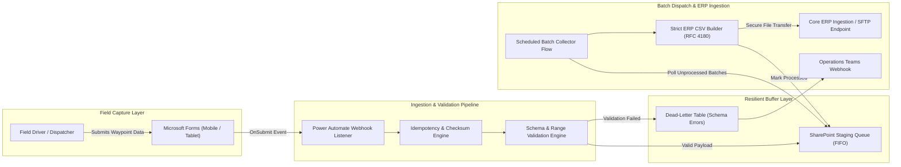
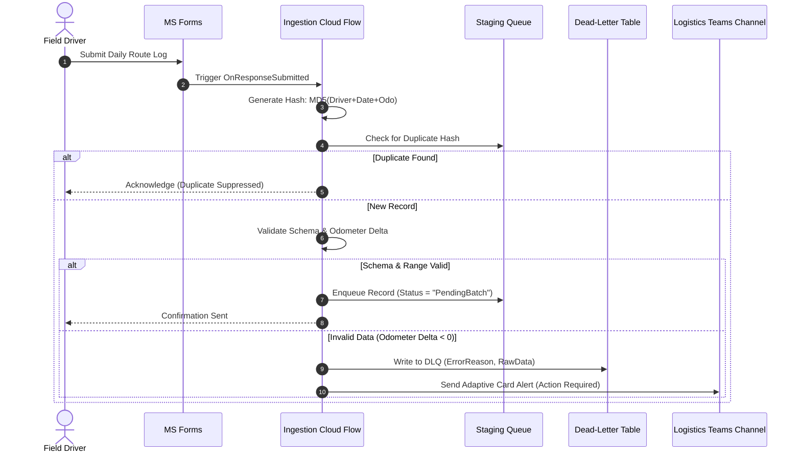

# Enterprise Integration Architecture & Technical Design

This document details the architectural decisions, asynchronous data pipelines, idempotency controls, and dead-letter queue (DLQ) implementations for the **Fleet Route Dispatch & ERP Sync Automation**.

---

## 1. System Topology & Pipeline Architecture

The platform bridges mobile field data capture (Microsoft Forms) with enterprise ERP batch financial processing, decoupling intake from ingestion through an asynchronous staging queue.

---

## 2. Architecture Decision Records (ADRs)

### ADR-001: Asynchronous Queue-Based Decoupling for ERP Ingestion

* **Status:** Accepted & Verified in Production
* **Context:** Dispatch drivers submit trip reports, multi-drop fuel delivery logs, and odometer waypoints from remote locations. Directly calling ERP SOAP/REST endpoints synchronously from the mobile trigger risks failure under spotty network conditions, ERP maintenance windows, or peak-hour throttling.
* **Decision:**
  * Adopt the **Compensating Queue-Based Load Leveling** pattern.
  * Microsoft Forms submissions write immediately to an intermediate **SharePoint Staging List** acting as a resilient FIFO queue.
  * A decoupled, scheduled cloud flow batches verified records into standardized CSV structures and delivers them to the ERP ingestion layer at controlled intervals.
* **Benefits:** 100% decoupled availability; zero dropped driver reports during ERP maintenance downtimes.

---

### ADR-002: Deterministic Idempotency Keying (Duplicate Suppression)

* **Status:** Accepted & Verified in Production
* **Context:** Due to poor network connectivity on rural delivery routes, drivers frequently resubmitted identical trip logs multiple times when mobile browsers stalled. Duplicate trip logs caused double-allocation of driver fuel allowances and inventory mismatch.
* **Decision:**
  * Compute a deterministic **Idempotency Hash** upon payload arrival:
    $$	ext{IdempotencyKey} = 	ext{MD5}(	ext{DriverID} + 	ext{TripDate} + 	ext{StartOdometer} + 	ext{StopCount})$$
  * The ingestion pipeline queries the Staging List using an indexed OData filter against `IdempotencyKey`. If an existing entry is found, the duplicate submission is acknowledged to the client without creating duplicate ERP line items.
* **Outcome:** 0% duplicate entries in ERP batch records.

---

### ADR-003: Dead-Letter Queue (DLQ) & Anomaly Isolation Pattern

* **Status:** Accepted & Verified in Production
* **Context:** Occasional invalid data (e.g., odometer rollback typos, negative cargo volumes, non-numeric timestamps) must not block downstream batch processing of valid driver logs.
* **Decision:**
  * Implement an automated **Dead-Letter Queue (DLQ)** pattern:
    1. Payloads that fail boundary or regex validation (e.g. `CurrentKm < PreviousKm`) are rejected from the staging queue.
    2. The malformed record is routed to the `Fleet_Dispatch_DLQ` table with the raw payload, error code, and driver contact metadata.
    3. An actionable Adaptive Card is dispatched to the Logistics Operations channel on Microsoft Teams for immediate dispatch resolution.
    4. Valid logs proceed through the pipeline without interruption.

---

## 3. Failure Modes & Mitigations Matrix

| Failure Scenario | Detection Mechanism | Impact | Architectural Mitigation |
| :--- | :--- | :--- | :--- |
| **ERP Endpoint Downtime** | SFTP / API connection failure during scheduled export | Batch file cannot be delivered | Batch flow retries up to 5 times with exponential backoff. Queue records remain `PendingBatch` until confirmed delivery |
| **Driver Double Submission** | Identical submission within short time frame | Duplicate mileage claim | Deterministic MD5 hash deduplication rejects duplicate payload |
| **Corrupted Special Characters** | Driver enters quotes, semicolons, or line breaks in notes | CSV format parsing error in ERP | Strict RFC 4180 sanitization: dynamic string escaping, replacement of delimiter characters, UTF-8 BOM encoding |
| **Missing Driver Identifier** | User not mapped to ERP Master Driver list | Unattributed delivery records | Lookup validation against Driver Master; unmatched IDs routed to DLQ with notification |

---

## 4. Throughput & Performance Metrics

* **Intake Latency:** Sub-second response time from MS Forms submission to Staging persistence.
* **Batch Processing Throughput:** 500+ waypoints formatted, validated, and packaged into ERP-compliant batch format in < 15 seconds.
* **Zero Data Loss Guarantee:** Queue persistence ensures no driver data is lost even during total downstream infrastructure interruptions.
