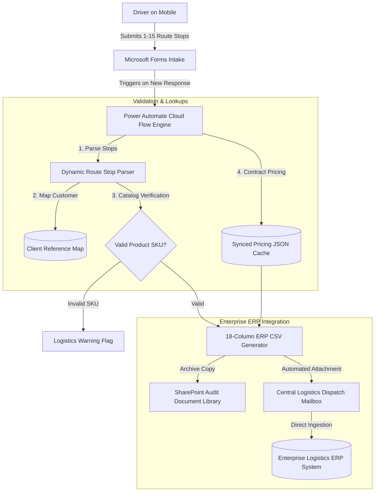

# Fleet Route Dispatch & ERP Sync Automation

[](https://powerautomate.microsoft.com/)
[](https://forms.office.com/)
[](#architecture--data-flow)
[](#)

> **Enterprise Case Study**: An automated pre-dispatch route reporting and ERP data pipeline for commercial distribution fleets. Replaces manual driver phone calls and Excel re-keying with a mobile-optimized intake form and an automated Power Automate Cloud Flow that validates catalog indexes, checks daily contract pricing, generates 18-column ERP-compliant CSV import batches, and routes dispatch notifications to central logistics planners.

---

## Business Impact & Metrics

* **Time Saved per Morning Dispatch**: Reduced route preparation and dispatch lag from **90 minutes to under 5 minutes** per driver.
* **Zero Format Errors**: 100% elimination of delimiter, quoting, and illegal character corruption in ERP import files.
* **Automated Price Sync**: Automates differential contract price lookups across 3,000+ customer accounts with daily scheduled updates.
* **Scale**: Successfully handling morning route dispatches across hundreds of active distribution points daily.

---

## Architecture & Data Flow



---

## Key System Components

### 1. Driver Intake Interface (Microsoft Forms)
- **Constraint Handling**: Solved Microsoft Forms dropdown option limits (character bounds per question) by building optimized option formatting algorithms combining customer identifier and town without exceeding payload boundaries.
- **Dynamic Route Structure**: Accommodates 1 to 15 stops per trip, capturing driver metadata, vehicle ID, date overrides, and up to 4 distinct commodity SKU quantities per stop.

### 2. Power Automate Cloud Flow Engine (25+ Structured Actions)
- **JSON Matrix Lookup**: Embeds fast client reference lookup tables into Flow Compose actions for instantaneous O(1) client ID resolution.
- **Product SKU Validation**: Verifies driver-entered commodity categories against the customer's authorized product profile, preventing dispatch rejections at loading bays.
- **ERP CSV Generation**: Builds strict RFC 4180-compliant CSV files with exact column ordering required by central ERP ingestion scripts (`TRANSACTION_TYPE`, `DISPATCH_ID`, `DRIVER_CODE`, `VEHICLE_IDENTIFIER`, `ROUTE_DATE`, `CUSTOMER_ACCOUNT_ID`, `COMMODITY_SKU_01`, `COMMODITY_SKU_02`, etc.).
- **Differential Daily Pricing Lookup**: Connects with an automated background price extractor that scans contract rate changes and populates billing remarks dynamically.

### 3. Error Handling & Auditing
- **Automated Anomaly Detection**: If a driver selects a discontinued or unmapped product code, the flow flags the row in an HTML alert table and routes priority warnings to the planning team.
- **Non-blocking Execution**: If optional price lookup files are temporarily undergoing sync, the dispatch flow gracefully proceeds using baseline contract configurations, ensuring zero disruption to morning physical departure schedules.

---

## Technical Specifications

| Parameter | Specification |
|:---|:---|
| **Platform** | Microsoft Power Automate Cloud Flow, Microsoft Forms |
| **Data Targets** | SharePoint Document Libraries, Central Logistics Mailbox, Enterprise ERP Batch |
| **Import Format** | Fixed 18-Column Semicolon/Comma-delimited CSV, UTF-8 / Windows-1250 |
| **Capacity** | Scalable route networks, 15 sequential stops per batch submission |
| **Execution Speed** | ~8-12 seconds from form submission to ERP CSV delivery |

---

## Repository Structure

```text
├── README.md                                  # Enterprise Architecture & Operations Guide
├── schema/
│   ├── erp-import-format.json                 # 18-column generic ERP logistics batch schema
│   └── client-reference-sample.json          # Sanitized customer reference mapping
└── templates/
    └── workflow-definition-spec.json          # Logic Apps / Flow definition skeleton
```

---

## Sanitization Notice
*All customer identifiers, proprietary ERP endpoint addresses, product index numbers, and personnel contact information have been fully sanitized with generic enterprise placeholders in accordance with standard data privacy guidelines.*
